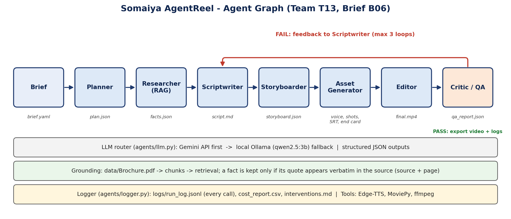

# Somaiya AgentReel - Team T13

Autonomous multi-agent pipeline that turns a brief (`brief.yaml`) into a 30-60 s promotional video for K J Somaiya School of Engineering. Built for the LY Agentic AI Laboratory evaluation.

**Team:** [Member 1 name], [Member 2 name] | **Faculty in-charge:** Dr Pankaj Mishra
**Brief used:** B06 - "Why Somaiya?" (aspirants, 9:16 vertical, English)

## Autonomy level: L4 (full autonomy)

One command runs the whole pipeline. The agents plan, research, write, storyboard, generate assets, edit and self-check. The human only starts the run. No generated file was edited by hand (see `logs/interventions.md`).

## Agent graph



Brief -> Planner -> Researcher (RAG) -> Scriptwriter -> Storyboarder -> Asset Generator -> Editor -> Critic.
If the Critic fails the video, it sends feedback back to the Scriptwriter (maximum 3 loops).

| Agent | Responsibility | Output |
|---|---|---|
| Planner | Turns the brief into stages and success criteria | `outputs/plan.json` |
| Researcher | Retrieves facts from the official brochure only; keeps a fact only if its quote appears verbatim in the source | `outputs/facts.json` |
| Scriptwriter | Timed voice-over script (hook, body, CTA); every body segment cites fact ids | `outputs/script.md` |
| Storyboarder | 6-8 shots with visuals, on-screen text and durations | `outputs/storyboard.json` |
| Asset Generator | Edge-TTS voice-over, captions and `.srt`, shot images, end card | `assets/`, `outputs/final.srt` |
| Editor | MoviePy + ffmpeg: Ken Burns zoom, captions, end card, loudness normalisation | `outputs/T13_B06_final.mp4` |
| Critic | Checks duration, resolution, fps, size, subtitles, AI-disclosure line, fact citations, unverified numbers/rankings | `outputs/qa_report.json` |

## Models and tools

- **LLM:** Gemini via its OpenAI-compatible API (primary, free tier); local Ollama `qwen2.5:3b` as automatic fallback
- **Voice:** Edge-TTS (`en-IN-NeerjaNeural`, synthetic voice)
- **Editing:** MoviePy 2.x, ffmpeg (loudnorm to about -14 LUFS), Pillow
- **PDF parsing / retrieval:** PyMuPDF with simple TF-IDF-style keyword retrieval

## How to run

```bash
# 1. Setup
python -m venv venv
venv\Scripts\activate              # Windows
pip install -r requirements.txt
# Install ffmpeg and Ollama; then: ollama pull qwen2.5:3b

# 2. Configure keys (never commit .env)
copy .env.example .env             # then fill in the values

# 3. Add sources
#    data/            -> official brochure / fact sheet (PDF or .txt)
#    assets/official/ -> official media-kit photos; logo file must start with "logo"

# 4. Run (one command)
python run.py --brief briefs/B06.yaml --seed 42
```

Output: `outputs/T13_B06_final.mp4`, `outputs/final.srt`, `outputs/qa_report.json`. Logs are written to `logs/`.

Note: Gemini does not honour the `seed` parameter, so repeated runs vary slightly. The seed is applied to the local fallback model.

## Results

| Item | Result |
|---|---|
| Format | 1080x1920, 30 fps, H.264 / AAC 48 kHz, captions burned in plus `.srt` |
| Length | within 30-60 s including the end card |
| QA | all Critic checks passed in both end-to-end runs |
| API spend per run | INR 0 (free tier and local tools; budget is INR 500) |
| Human interventions | 0 |

Every claim in the video traces to `outputs/facts.json`, which stores the source file, page number and verbatim quote.

## Repository structure

```
agentreel-T13/
|-- README.md  run.py  requirements.txt  .env.example
|-- briefs/    brief.yaml files
|-- agents/    planner, researcher, scriptwriter, storyboarder, asset_generator, editor, critic, llm, logger, utils
|-- prompts/   all prompt templates (versioned)
|-- data/      official brochure / fact sheet as provided
|-- assets/    official/ photos, generated shots, audio, manifest.csv (source + licence)
|-- outputs/   final video, .srt, qa_report.json, facts.json, script.md
|-- logs/      run_log.jsonl, cost_report.csv, interventions.md
`-- docs/      agent_graph.png, process_report.pdf
```

## Responsible-AI notes

- Facts come only from the official brochure; no web-scraped statistics.
- Only official media-kit photos are used. No real or generated faces and no cloned voices.
- The voice is a synthetic Edge-TTS voice. The end card carries the line "Created with AI agents - LY Agentic AI Lab".
- API keys are kept in `.env`, which is excluded by `.gitignore`.

## Credits

- Edge-TTS, MoviePy, ffmpeg, Pillow, PyMuPDF, PyYAML, python-dotenv, OpenAI Python SDK (used as the client for the Gemini and Ollama endpoints), Ollama and Qwen2.5.
- No code was copied from tutorials or other repositories beyond library usage examples from their documentation.
